# Spesifikasi Database & Skema — Dar Al Tauhid EMS

**Dokumen Terkait:** [PRD.md](file:///c:/laragon/www/daraltauhid/docs/PRD.md) · [TECHSTACK.md](file:///c:/laragon/www/daraltauhid/docs/TECHSTACK.md) · [MODULES.md](file:///c:/laragon/www/daraltauhid/docs/MODULES.md) · [DESIGN.md](file:///c:/laragon/www/daraltauhid/docs/DESIGN.md) · [ROADMAP.md](file:///c:/laragon/www/daraltauhid/docs/ROADMAP.md)

---

## 1. Filosofi & Strategi Multi-Tenancy

Dar Al Tauhid EMS menggunakan arsitektur **Logical Multi-Tenancy (Single Database, Shared Schema)**. Seluruh data lembaga (Pondok Pesantren, SMP Plus, MA Nusantara, dan MI) disimpan dalam satu database MySQL/MariaDB yang sama.

### Prinsip Utama:
1. **Pemisahan Data Melalui Kolom `institution_id`:** Setiap entitas yang dimiliki atau terikat pada lembaga tertentu memiliki kolom `institution_id` bertipe `bigint unsigned`.
2. **Otomatisasi Via Laravel Global Scope:** Setiap query Eloquent ke model yang memiliki kolom `institution_id` secara otomatis disaring menggunakan Global Scope:
   ```php
   static::addGlobalScope('institution', function (Builder $builder) {
       if (auth()->check() && auth()->user()->current_institution_id) {
           $builder->where('institution_id', auth()->user()->current_institution_id);
       }
   });
   ```
3. **Single Source of Truth Santri:** Master data santri (`students`) disimpan secara global tanpa `institution_id` langsung pada tabel induk, melainkan dihubungkan melalui tabel pivot `student_institution`. Hal ini memungkinkan seorang santri terdaftar di Pondok Pesantren sekaligus di SMP Plus dalam tahun ajaran yang sama tanpa penggandaan biodata.
4. **Validasi Anti-Dobel Santri:** Pengecekan keunikan nomor NIK (`nik`) dan NISN (`nisn`) dilakukan secara ketat pada tabel `students`.
5. **Keanggotaan Lembaga Kanonik:** Keanggotaan pengguna diatur melalui tabel pivot `institution_user` (atau `team_user` bawaan Teams Laravel). Sesi aktif pengguna (`current_institution_id`) wajib selalu divalidasi ke tabel ini sebelum setiap request diproses.

---

## 2. Diagram Relasi Entitas (Entity Relationship Diagram)

```mermaid
erDiagram
    INSTITUTIONS ||--o{ INSTITUTION_USER : "keanggotaan pengguna"
    USERS ||--o{ INSTITUTION_USER : "terdaftar di"
    INSTITUTIONS ||--o{ ACADEMIC_YEARS : "memiliki periode"
    INSTITUTIONS ||--o{ STUDENT_INSTITUTION : "menaungi santri"
    INSTITUTIONS ||--o{ ROLES : "peran per lembaga"
    INSTITUTIONS ||--o{ REGISTRATIONS : "tujuan pendaftaran"
    INSTITUTIONS ||--o{ CLASSES : "memiliki kelas"
    INSTITUTIONS ||--o{ DORM_ROOMS : "memiliki kamar asrama"
    INSTITUTIONS ||--o{ INVOICE_TYPES : "master tarif tagihan"
    INSTITUTIONS ||--o{ PAGES : "halaman profil"
    INSTITUTIONS ||--o{ ANNOUNCEMENTS : "pengumuman publik"

    STUDENTS ||--o{ STUDENT_INSTITUTION : "terdaftar di lembaga"
    ACADEMIC_YEARS ||--o{ STUDENT_INSTITUTION : "tahun ajaran aktif"

    USERS ||--o{ MODEL_HAS_ROLES : "memiliki peran"
    ROLES ||--o{ MODEL_HAS_ROLES : "diberikan kepada"
    ROLES ||--o{ ROLE_HAS_PERMISSIONS : "memiliki izin"
    PERMISSIONS ||--o{ ROLE_HAS_PERMISSIONS : "melekat pada"

    REGISTRATIONS ||--o{ REGISTRATION_DOCUMENTS : "melampirkan berkas"
    REGISTRATIONS ||--o| STUDENTS : "lulus menjadi santri"

    CLASSES ||--o{ CLASS_STUDENT : "plotting siswa"
    STUDENTS ||--o{ CLASS_STUDENT : "ditempatkan di kelas"
    CLASSES ||--o{ ATTENDANCES : "presensi harian"
    STUDENTS ||--o{ ATTENDANCES : "catatan kehadiran"
    STUDENTS ||--o{ GRADES : "memperoleh nilai"
    SUBJECTS ||--o{ GRADES : "dinilai pada mapel"
    CLASSES ||--o{ SCHEDULES : "memiliki jadwal"
    SUBJECTS ||--o{ SCHEDULES : "diajarkan pada jadwal"

    DORM_ROOMS ||--o{ ROOM_MEMBERS : "penghuni kamar"
    STUDENTS ||--o{ ROOM_MEMBERS : "menempati kamar"
    DORM_ROOMS ||--o{ ROOM_SUPERVISORS : "pembina kamar"
    USERS ||--o{ ROOM_SUPERVISORS : "ditugaskan sebagai pembina"
    STUDENTS ||--o{ TAHFIDZ_RECORDS : "setoran hafalan"
    STUDENTS ||--o{ VIOLATIONS : "catatan kedisiplinan"
    STUDENTS ||--o{ PERMITS : "izin keluar/pulang"
    USERS ||--o{ PERMITS : "disetujui oleh"

    STUDENTS ||--o{ INVOICES : "tagihan santri"
    INVOICE_TYPES ||--o{ INVOICES : "jenis tarif"
    INVOICES ||--o{ PAYMENTS : "bukti pembayaran"

    USERS ||--o{ ARTICLES : "penulis berita"
```



---

## 3. Rincian Skema Tabel Lengkap

### 3.1 Tabel Inti & Organisasi

#### `institutions` — Master Lembaga / Tenant
Menyimpan data unit lembaga yang bernaung di bawah Yayasan Dar Al Tauhid.
| Kolom | Tipe | Nullable | Keterangan & Index |
|---|---|---|---|
| `id` | bigint unsigned | No | Primary Key |
| `name` | varchar(255) | No | Nama lengkap lembaga (mis. "SMP Plus Dar Al Tauhid") |
| `slug` | varchar(100) | No | Unique identifier / subdomain slug (mis. "smp", "pondok") |
| `type` | enum('formal','non_formal') | No | Klasifikasi jenis lembaga |
| `address` | text | Yes | Alamat fisik operasional lembaga |
| `phone` | varchar(50) | Yes | Nomor telepon resmi kantor lembaga |
| `is_active` | boolean | No | Default: `true`. Status operasional lembaga |
| `created_at` | timestamp | Yes | Waktu data dibuat |
| `updated_at` | timestamp | Yes | Waktu data diubah |

#### `users` — Akun Pengguna Terpusat
Menyimpan identitas autentikasi semua pengguna aplikasi yayasan.
| Kolom | Tipe | Nullable | Keterangan & Index |
|---|---|---|---|
| `id` | bigint unsigned | No | Primary Key |
| `name` | varchar(255) | No | Nama lengkap pengguna |
| `email` | varchar(255) | No | Unique index. Email login pengguna |
| `password` | varchar(255) | No | Password ter-hash (Bcrypt/Argon2) |
| `phone` | varchar(50) | Yes | Nomor WhatsApp aktif untuk notifikasi |
| `current_institution_id` | bigint unsigned | Yes | Foreign Key ke `institutions.id`. Lembaga aktif sesi ini |
| `is_active` | boolean | No | Default: `true`. Status akun pengguna |
| `remember_token` | varchar(100) | Yes | Token otentikasi login persisten |
| `created_at` | timestamp | Yes | Waktu akun dibuat |
| `updated_at` | timestamp | Yes | Waktu akun diubah |

#### `institution_user` — Pivot Keanggotaan Lembaga (Teams)
Tabel kanonik yang menentukan lembaga apa saja yang dapat diakses oleh seorang pengguna.
| Kolom | Tipe | Nullable | Keterangan & Index |
|---|---|---|---|
| `id` | bigint unsigned | No | Primary Key |
| `user_id` | bigint unsigned | No | Foreign Key ke `users.id` (Cascade on delete) |
| `institution_id` | bigint unsigned | No | Foreign Key ke `institutions.id` (Cascade on delete) |
| `role_label` | varchar(100) | Yes | Label jabatan (mis. "Kepala Sekolah", "Guru", "Wali Santri") |
| `is_default` | boolean | No | Default: `false`. Penanda lembaga default saat login pertama |
| `status` | enum('active','inactive') | No | Default: `'active'`. Akses ditolak bila inactive |
| `joined_at` | date | Yes | Tanggal efektif mulai bertugas di lembaga |
| `created_at` | timestamp | Yes | Waktu pencatatan |
| `updated_at` | timestamp | Yes | Waktu pembaruan |
| *Index* | `unique(user_id, institution_id)` | — | Mencegah keanggotaan ganda pada satu lembaga |

#### `academic_years` — Periode Tahun Ajaran
Menyimpan kalender tahun ajaran per lembaga.
| Kolom | Tipe | Nullable | Keterangan & Index |
|---|---|---|---|
| `id` | bigint unsigned | No | Primary Key |
| `institution_id` | bigint unsigned | No | Foreign Key ke `institutions.id` |
| `name` | varchar(50) | No | Nama tahun ajaran (mis. "2025/2026") |
| `start_date` | date | No | Tanggal mulai tahun ajaran |
| `end_date` | date | No | Tanggal berakhir tahun ajaran |
| `is_active` | boolean | No | Default: `false`. Penanda tahun ajaran berjalan |
| `created_at` | timestamp | Yes | Timestamps |
| `updated_at` | timestamp | Yes | Timestamps |
| *Index* | `index(institution_id, is_active)` | — | Mempercepat pencarian tahun ajaran aktif lembaga |

---

### 3.2 Tabel Santri Terpadu (Single Source of Truth)

#### `students` — Master Biodata Santri
Biodata individu santri yang bersifat global dan mandiri di seluruh yayasan.
| Kolom | Tipe | Nullable | Keterangan & Index |
|---|---|---|---|
| `id` | bigint unsigned | No | Primary Key |
| `nik` | varchar(20) | No | **Unique index.** Nomor Induk Kependudukan (anti-dobel) |
| `nisn` | varchar(20) | Yes | **Unique index.** Nomor Induk Siswa Nasional |
| `name` | varchar(255) | No | Nama lengkap santri |
| `gender` | enum('L','P') | No | Jenis kelamin santri |
| `dob` | date | No | Tanggal lahir |
| `pob` | varchar(100) | No | Tempat lahir |
| `parent_name` | varchar(255) | No | Nama ayah/ibu/wali santri |
| `parent_phone` | varchar(50) | No | Nomor kontak WhatsApp wali |
| `address` | text | No | Alamat tempat tinggal santri |
| `external_school` | varchar(255) | Yes | Sekolah luar yayasan (mis. "MTsN 3 Cirebon") |
| `photo_path` | varchar(255) | Yes | Path penyimpanan pasfoto santri |
| `data_completeness` | tinyint unsigned | No | Default: `0` (0-100%). Skor kelengkapan isian biodata |
| `created_at` | timestamp | Yes | Timestamps |
| `updated_at` | timestamp | Yes | Timestamps |

#### `student_institution` — Pivot Pendaftaran Santri di Lembaga
Menghubungkan santri dengan satu atau lebih unit lembaga aktif.
| Kolom | Tipe | Nullable | Keterangan & Index |
|---|---|---|---|
| `id` | bigint unsigned | No | Primary Key |
| `student_id` | bigint unsigned | No | Foreign Key ke `students.id` (Cascade on delete) |
| `institution_id` | bigint unsigned | No | Foreign Key ke `institutions.id` (Cascade on delete) |
| `academic_year_id` | bigint unsigned | No | Foreign Key ke `academic_years.id` |
| `student_no` | varchar(50) | Yes | Nomor Induk Santri lokal lembaga (NIS/NIP) |
| `status` | enum('active','graduated','dropped_out') | No | Default: `'active'` |
| `joined_at` | date | No | Tanggal santri mulai aktif di lembaga |
| `created_at` | timestamp | Yes | Timestamps |
| `updated_at` | timestamp | Yes | Timestamps |
| *Index* | `unique(student_id, institution_id, academic_year_id)` | — | Mencegah penautan ganda di periode yang sama |

---

### 3.3 Tabel Hak Akses & Peran (Spatie Teams Mode)

#### `roles`
| Kolom | Tipe | Nullable | Keterangan |
|---|---|---|---|
| `id` | bigint unsigned | No | Primary Key |
| `institution_id` | bigint unsigned | Yes | Nullable untuk super admin yayasan, terisi untuk peran lokal |
| `name` | varchar(255) | No | Nama peran (mis. "Admin", "Guru", "Musyrif", "Wali") |
| `guard_name` | varchar(255) | No | Default: `'web'` |
| `created_at` | timestamp | Yes | Timestamps |
| `updated_at` | timestamp | Yes | Timestamps |

#### `permissions`
| Kolom | Tipe | Nullable | Keterangan |
|---|---|---|---|
| `id` | bigint unsigned | No | Primary Key |
| `name` | varchar(255) | No | Nama izin (mis. `student.view`, `grade.edit`) |
| `guard_name` | varchar(255) | No | Default: `'web'` |
| `created_at` | timestamp | Yes | Timestamps |
| `updated_at` | timestamp | Yes | Timestamps |

#### `model_has_roles`
| Kolom | Tipe | Nullable | Keterangan & Index |
|---|---|---|---|
| `role_id` | bigint unsigned | No | Foreign Key ke `roles.id` |
| `model_type` | varchar(255) | No | Namespace model (`App\Models\User`) |
| `model_id` | bigint unsigned | No | ID entitas user |
| `institution_id` | bigint unsigned | No | **Krusial:** Lembaga tempat peran tersebut berlaku |
| *Index* | `primary(role_id, model_id, model_type, institution_id)` | — | Composite primary key Spatie Teams |

#### `role_has_permissions`
| Kolom | Tipe | Nullable | Keterangan |
|---|---|---|---|
| `permission_id` | bigint unsigned | No | Foreign Key ke `permissions.id` |
| `role_id` | bigint unsigned | No | Foreign Key ke `roles.id` |
| *Index* | `primary(permission_id, role_id)` | — | Composite primary key |

---

### 3.4 Tabel Penerimaan Santri Baru (PSB)

#### `registrations` — Pendaftaran Calon Santri
| Kolom | Tipe | Nullable | Keterangan |
|---|---|---|---|
| `id` | bigint unsigned | No | Primary Key |
| `registration_no` | varchar(50) | No | **Unique index.** Nomor bukti pendaftaran (mis. "PSB-2025-001") |
| `institution_id` | bigint unsigned | No | Foreign Key ke `institutions.id` (Lembaga tujuan) |
| `academic_year_id` | bigint unsigned | No | Foreign Key ke `academic_years.id` |
| `full_name` | varchar(255) | No | Nama lengkap calon santri |
| `nik` | varchar(20) | No | NIK calon santri (divalidasi anti-dobel saat dipromosikan) |
| `gender` | enum('L','P') | No | Jenis kelamin |
| `dob` | date | No | Tanggal lahir calon santri |
| `pob` | varchar(100) | No | Tempat lahir calon santri |
| `parent_name` | varchar(255) | No | Nama orang tua / wali |
| `parent_phone` | varchar(50) | No | Nomor WhatsApp wali aktif |
| `parent_email` | varchar(255) | Yes | Email wali santri untuk pembuatan akun |
| `address` | text | No | Alamat tempat tinggal |
| `status` | enum('draft','submitted','verified','passed','failed') | No | Default: `'draft'` |
| `note` | text | Yes | Catatan hasil telaah berkas panitia |
| `created_at` | timestamp | Yes | Timestamps |
| `updated_at` | timestamp | Yes | Timestamps |

#### `registration_documents` — Berkas Unggahan PSB
| Kolom | Tipe | Nullable | Keterangan |
|---|---|---|---|
| `id` | bigint unsigned | No | Primary Key |
| `registration_id` | bigint unsigned | No | Foreign Key ke `registrations.id` (Cascade on delete) |
| `type` | enum('kk','akta','photo','other') | No | Jenis berkas persyaratan |
| `file_path` | varchar(255) | No | Lokasi file pada storage |
| `is_verified` | boolean | No | Default: `false`. Status verifikasi berkas |
| `created_at` | timestamp | Yes | Timestamps |
| `updated_at` | timestamp | Yes | Timestamps |

---

### 3.5 Tabel Akademik Sekolah

#### `classes` — Kelas & Rombongan Belajar
| Kolom | Tipe | Nullable | Keterangan |
|---|---|---|---|
| `id` | bigint unsigned | No | Primary Key |
| `institution_id` | bigint unsigned | No | Foreign Key ke `institutions.id` |
| `academic_year_id` | bigint unsigned | No | Foreign Key ke `academic_years.id` |
| `name` | varchar(100) | No | Nama kelas (mis. "7A", "8B", "10 IPA") |
| `level` | tinyint unsigned | No | Tingkat jenjang (mis. 7, 8, 9) |
| `homeroom_teacher_id` | bigint unsigned | Yes | Foreign Key ke `users.id` (Wali kelas) |
| `created_at` | timestamp | Yes | Timestamps |
| `updated_at` | timestamp | Yes | Timestamps |

#### `subjects` — Mata Pelajaran
| Kolom | Tipe | Nullable | Keterangan |
|---|---|---|---|
| `id` | bigint unsigned | No | Primary Key |
| `institution_id` | bigint unsigned | No | Foreign Key ke `institutions.id` |
| `name` | varchar(255) | No | Nama mapel (mis. "Matematika", "Bahasa Arab") |
| `code` | varchar(50) | No | Kode mapel (mis. "MTK-7", "ARB-01") |
| `created_at` | timestamp | Yes | Timestamps |
| `updated_at` | timestamp | Yes | Timestamps |

#### `schedules` — Jadwal Pelajaran
| Kolom | Tipe | Nullable | Keterangan |
|---|---|---|---|
| `id` | bigint unsigned | No | Primary Key |
| `class_id` | bigint unsigned | No | Foreign Key ke `classes.id` |
| `subject_id` | bigint unsigned | No | Foreign Key ke `subjects.id` |
| `teacher_id` | bigint unsigned | No | Foreign Key ke `users.id` (Guru pengampu) |
| `day` | tinyint unsigned | No | Hari (1 = Senin s/d 7 = Ahad) |
| `start_time` | time | No | Jam mulai |
| `end_time` | time | No | Jam selesai |
| `created_at` | timestamp | Yes | Timestamps |
| `updated_at` | timestamp | Yes | Timestamps |

#### `class_student` — Penempatan Siswa di Kelas
| Kolom | Tipe | Nullable | Keterangan |
|---|---|---|---|
| `id` | bigint unsigned | No | Primary Key |
| `class_id` | bigint unsigned | No | Foreign Key ke `classes.id` |
| `student_id` | bigint unsigned | No | Foreign Key ke `students.id` |
| `academic_year_id` | bigint unsigned | No | Foreign Key ke `academic_years.id` |
| `created_at` | timestamp | Yes | Timestamps |
| `updated_at` | timestamp | Yes | Timestamps |
| *Index* | `unique(class_id, student_id, academic_year_id)` | — | Mencegah penempatan ganda |

#### `attendances` — Presensi Siswa
| Kolom | Tipe | Nullable | Keterangan |
|---|---|---|---|
| `id` | bigint unsigned | No | Primary Key |
| `class_id` | bigint unsigned | No | Foreign Key ke `classes.id` |
| `student_id` | bigint unsigned | No | Foreign Key ke `students.id` |
| `date` | date | No | Tanggal presensi |
| `status` | enum('hadir','izin','sakit','alpa') | No | Status kehadiran |
| `note` | varchar(255) | Yes | Catatan keterangan |
| `recorded_by` | bigint unsigned | No | Foreign Key ke `users.id` (Pencatat absensi) |
| `created_at` | timestamp | Yes | Timestamps |
| `updated_at` | timestamp | Yes | Timestamps |
| *Index* | `unique(class_id, student_id, date)` | — | Mencegah presensi dobel per tanggal |

#### `grades` — Penilaian & Nilai Rapor
| Kolom | Tipe | Nullable | Keterangan |
|---|---|---|---|
| `id` | bigint unsigned | No | Primary Key |
| `student_id` | bigint unsigned | No | Foreign Key ke `students.id` |
| `subject_id` | bigint unsigned | No | Foreign Key ke `subjects.id` |
| `academic_year_id` | bigint unsigned | No | Foreign Key ke `academic_years.id` |
| `type` | varchar(50) | No | Jenis nilai (mis. 'tugas_1', 'uts', 'uas', 'rapor') |
| `score` | decimal(5,2) | No | Nilai angka (0.00 s/d 100.00) |
| `semester` | tinyint unsigned | No | Semester (1 = Ganjil, 2 = Genap) |
| `note` | varchar(255) | Yes | Deskripsi capaian kompetensi |
| `created_at` | timestamp | Yes | Timestamps |
| `updated_at` | timestamp | Yes | Timestamps |

---

### 3.6 Tabel Kepesantrenan

#### `dorm_rooms` — Kamar Asrama
| Kolom | Tipe | Nullable | Keterangan |
|---|---|---|---|
| `id` | bigint unsigned | No | Primary Key |
| `institution_id` | bigint unsigned | No | Foreign Key ke `institutions.id` |
| `name` | varchar(100) | No | Nama kamar (mis. "Kamar Al-Fatih 1") |
| `capacity` | tinyint unsigned | No | Kapasitas maksimal santri |
| `gender` | enum('L','P') | No | Peruntukan asrama putra/putri |
| `created_at` | timestamp | Yes | Timestamps |
| `updated_at` | timestamp | Yes | Timestamps |

#### `room_members` — Penghuni Kamar
| Kolom | Tipe | Nullable | Keterangan |
|---|---|---|---|
| `id` | bigint unsigned | No | Primary Key |
| `dorm_room_id` | bigint unsigned | No | Foreign Key ke `dorm_rooms.id` |
| `student_id` | bigint unsigned | No | Foreign Key ke `students.id` |
| `academic_year_id` | bigint unsigned | No | Foreign Key ke `academic_years.id` |
| `joined_at` | date | No | Tanggal mulai menempati kamar |
| `created_at` | timestamp | Yes | Timestamps |
| `updated_at` | timestamp | Yes | Timestamps |

#### `room_supervisors` — Musyrif / Pembina Kamar
| Kolom | Tipe | Nullable | Keterangan |
|---|---|---|---|
| `id` | bigint unsigned | No | Primary Key |
| `dorm_room_id` | bigint unsigned | No | Foreign Key ke `dorm_rooms.id` |
| `user_id` | bigint unsigned | No | Foreign Key ke `users.id` (Akun musyrif) |
| `role` | enum('pembina','musyrif') | No | Default: `'musyrif'` |
| `created_at` | timestamp | Yes | Timestamps |
| `updated_at` | timestamp | Yes | Timestamps |

#### `tahfidz_records` — Setoran Hafalan Al-Qur'an
| Kolom | Tipe | Nullable | Keterangan |
|---|---|---|---|
| `id` | bigint unsigned | No | Primary Key |
| `student_id` | bigint unsigned | No | Foreign Key ke `students.id` |
| `surah` | varchar(100) | No | Nama surah yang disetor |
| `verse_from` | smallint unsigned | No | Dari ayat |
| `verse_to` | smallint unsigned | No | Sampai ayat |
| `juz` | tinyint unsigned | No | Juz ke (1-30) |
| `score` | varchar(10) | Yes | Predikat kelancaran (mis. 'A', 'B', 'Mumtaz') |
| `assessment_date` | date | No | Tanggal ujian setoran |
| `supervisor_id` | bigint unsigned | No | Foreign Key ke `users.id` (Musyrif penguji) |
| `note` | text | Yes | Catatan makharijul huruf atau tajwid |
| `created_at` | timestamp | Yes | Timestamps |
| `updated_at` | timestamp | Yes | Timestamps |

#### `violations` — Catatan Pelanggaran Kedisiplinan
| Kolom | Tipe | Nullable | Keterangan |
|---|---|---|---|
| `id` | bigint unsigned | No | Primary Key |
| `student_id` | bigint unsigned | No | Foreign Key ke `students.id` |
| `type` | varchar(100) | No | Kategori pelanggaran (mis. "Ringan", "Sedang", "Berat") |
| `description` | text | No | Kronologi pelanggaran |
| `points` | smallint unsigned | No | Poin pelanggaran |
| `action_taken` | text | Yes | Sanksi / tindakan pembinaan yang diberikan |
| `date` | date | No | Tanggal kejadian |
| `recorded_by` | bigint unsigned | No | Foreign Key ke `users.id` |
| `created_at` | timestamp | Yes | Timestamps |
| `updated_at` | timestamp | Yes | Timestamps |

#### `permits` — Perizinan Santri (Keluar / Pulang)
| Kolom | Tipe | Nullable | Keterangan |
|---|---|---|---|
| `id` | bigint unsigned | No | Primary Key |
| `student_id` | bigint unsigned | No | Foreign Key ke `students.id` |
| `type` | enum('keluar','pulang') | No | Jenis izin |
| `reason` | text | No | Alasan perizinan |
| `start_date` | datetime | No | Waktu mulai keluar/pulang |
| `end_date` | datetime | No | Batas waktu kembali ke pondok |
| `status` | enum('pending','approved','rejected','returned') | No | Default: `'pending'` |
| `approved_by` | bigint unsigned | Yes | Foreign Key ke `users.id` (Petugas pemberi izin) |
| `created_at` | timestamp | Yes | Timestamps |
| `updated_at` | timestamp | Yes | Timestamps |

---

### 3.7 Tabel Keuangan

#### `invoice_types` — Master Tarif Tagihan
| Kolom | Tipe | Nullable | Keterangan |
|---|---|---|---|
| `id` | bigint unsigned | No | Primary Key |
| `institution_id` | bigint unsigned | No | Foreign Key ke `institutions.id` |
| `name` | varchar(100) | No | Nama tagihan (mis. "SPP Bulanan", "Syahriyah Pondok") |
| `amount` | decimal(12,2) | No | Besaran nominal standar |
| `period` | enum('monthly','yearly','once') | No | Frekuensi siklus tagihan |
| `created_at` | timestamp | Yes | Timestamps |
| `updated_at` | timestamp | Yes | Timestamps |

#### `invoices` — Lembar Tagihan Santri
| Kolom | Tipe | Nullable | Keterangan |
|---|---|---|---|
| `id` | bigint unsigned | No | Primary Key |
| `student_id` | bigint unsigned | No | Foreign Key ke `students.id` |
| `institution_id` | bigint unsigned | No | Foreign Key ke `institutions.id` |
| `invoice_type_id` | bigint unsigned | No | Foreign Key ke `invoice_types.id` |
| `academic_year_id` | bigint unsigned | No | Foreign Key ke `academic_years.id` |
| `amount` | decimal(12,2) | No | Besaran kewajiban tagihan |
| `due_date` | date | No | Tanggal jatuh tempo |
| `status` | enum('unpaid','partial','paid') | No | Default: `'unpaid'` |
| `created_at` | timestamp | Yes | Timestamps |
| `updated_at` | timestamp | Yes | Timestamps |

#### `payments` — Transaksi Pembayaran
| Kolom | Tipe | Nullable | Keterangan |
|---|---|---|---|
| `id` | bigint unsigned | No | Primary Key |
| `invoice_id` | bigint unsigned | No | Foreign Key ke `invoices.id` |
| `amount` | decimal(12,2) | No | Jumlah uang yang disetorkan |
| `paid_at` | datetime | No | Waktu transaksi dilakukan |
| `method` | varchar(50) | No | Metode pembayaran (mis. "Tunai", "Transfer BSI") |
| `reference_no` | varchar(100) | Yes | Nomor resi transaksi / referensi bank |
| `recorded_by` | bigint unsigned | No | Foreign Key ke `users.id` (Petugas kasir) |
| `created_at` | timestamp | Yes | Timestamps |
| `updated_at` | timestamp | Yes | Timestamps |

---

### 3.8 Tabel CMS & Publikasi Publik

#### `pages` — Halaman Statis Profil
| Kolom | Tipe | Nullable | Keterangan |
|---|---|---|---|
| `id` | bigint unsigned | No | Primary Key |
| `institution_id` | bigint unsigned | Yes | Nullable untuk halaman profil yayasan pusat |
| `slug` | varchar(100) | No | URL slug (mis. "sejarah-pesantren", "profil-mi") |
| `title` | varchar(255) | No | Judul halaman |
| `content` | longtext | No | Isi konten profil (HTML/Markdown) |
| `is_published` | boolean | No | Default: `true` |
| `published_at` | datetime | Yes | Waktu tayang publik |
| `created_at` | timestamp | Yes | Timestamps |
| `updated_at` | timestamp | Yes | Timestamps |

#### `articles` — Artikel & Berita Publik
| Kolom | Tipe | Nullable | Keterangan |
|---|---|---|---|
| `id` | bigint unsigned | No | Primary Key |
| `institution_id` | bigint unsigned | Yes | Nullable untuk berita yayasan umum |
| `title` | varchar(255) | No | Judul artikel |
| `slug` | varchar(255) | No | **Unique index.** Slug URL artikel berita |
| `excerpt` | text | Yes | Ringkasan singkat untuk kartu preview berita |
| `body` | longtext | No | Konten lengkap artikel |
| `thumbnail_path` | varchar(255) | Yes | Gambar sampul artikel |
| `author_id` | bigint unsigned | No | Foreign Key ke `users.id` |
| `is_published` | boolean | No | Default: `false` |
| `published_at` | datetime | Yes | Waktu publikasi |
| `created_at` | timestamp | Yes | Timestamps |
| `updated_at` | timestamp | Yes | Timestamps |

#### `announcements` — Pengumuman Publik
| Kolom | Tipe | Nullable | Keterangan |
|---|---|---|---|
| `id` | bigint unsigned | No | Primary Key |
| `institution_id` | bigint unsigned | Yes | Nullable untuk pengumuman seluruh yayasan |
| `title` | varchar(255) | No | Judul banner pengumuman |
| `content` | text | No | Detail teks pengumuman |
| `start_date` | date | No | Tanggal mulai tampil |
| `end_date` | date | Yes | Tanggal berakhir tampil |
| `is_public` | boolean | No | Default: `true` |
| `created_at` | timestamp | Yes | Timestamps |
| `updated_at` | timestamp | Yes | Timestamps |

---

## 4. Panduan Indexing & Optimasi Kueri

Mengingat hosting berada di shared environment Hostinger:
1. **Wajib Composite Index pada `institution_id`:** Semua tabel anak wajib memiliki index pada kolom `(institution_id, created_at)` atau `(institution_id, academic_year_id)`.
2. **Indeks Keunikan Kependudukan:** Tabel `students` memiliki indeks unik pada `nik` dan `nisn` untuk menjamin integritas pencegahan data ganda di tingkat mesin database.
3. **Eager Loading Relasi:** Pada controller Inertia, selalu gunakan `with()` untuk mencegah problem N+1 Query (misal saat meload data santri beserta lembaga dan kelasnya).
